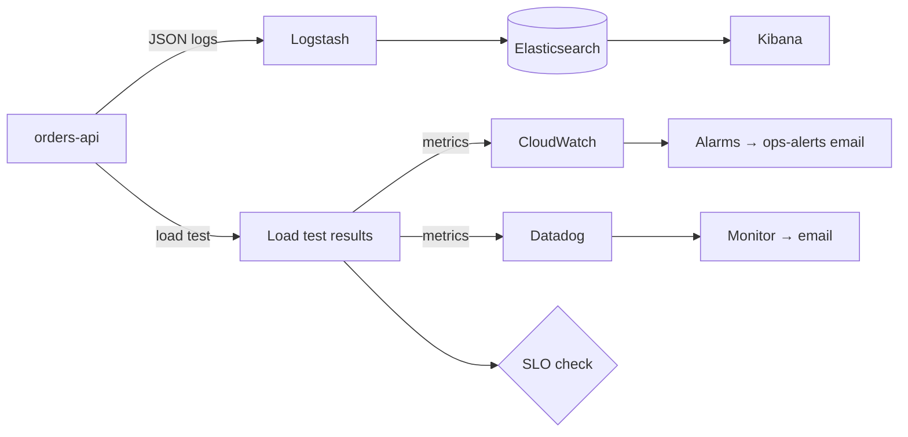

# Centralised monitoring and observability

One service, three ways to watch it, all checked on every push:
**logs** go through Logstash into Elasticsearch and Kibana, **metrics and alarms** live in AWS CloudWatch, and **Datadog** monitors the same signals.
If any of them stops working, the pipeline goes red.

[Live pipeline →](https://danielkojomegbenu.com/projects/observability-platform)

## The pipeline



| Step | What happens | Fails the run when |
|---|---|---|
| 1. Unit tests | Tests the service and its log format | A test fails |
| 2. Start the logging stack | `docker compose` starts orders-api, Logstash, Elasticsearch and Kibana, and waits until all four are healthy | A part of the stack doesn't come up |
| 3. Load test | 400 requests (half orders, half checkouts) plus 50 health probes. Records error rate, p95 latency and uptime | |
| 4. Logstash → Elasticsearch | Every request's log line must arrive in Elasticsearch with numeric fields | A log line is lost or isn't parsed |
| 5. Kibana | Imports a data view and two saved searches: **Errors** and **Slow requests** | Kibana rejects them |
| 6. CloudWatch | Publishes the three metrics and checks the two alarms watching them exist | AWS rejects the metrics or an alarm is missing |
| 7. Datadog | Sends the same three metrics, which the Datadog monitor watches | Datadog rejects them |
| 8. SLO check | Uptime ≥ 99.9%, error rate ≤ 1%, p95 latency ≤ 300 ms | The service misses an objective |

The SLO check runs last on purpose: when something is wrong, the metrics have already reached CloudWatch and Datadog, so the alarms fire as they would in production.

## Why it makes incidents faster to diagnose

- **Structured logs.** Every request is one JSON line (`level`, `path`, `status`, `latency_ms`, `trace_id`), so Logstash needs no regex and Kibana can filter on any field.
- **Saved searches.** Kibana opens straight to **Errors: orders-api**, so nobody writes queries mid-incident.
- **Shared thresholds.** The SLO check, the CloudWatch alarms and the Datadog monitor all use the same numbers, so every tool agrees on what "broken" means.
- **Alerts that point at the evidence.** The Datadog alert tells you which Kibana search to open and to follow the `trace_id`.

## See an error spike stop the pipeline

Open the pull request **demo/error-spike**. It makes 1 in 10 checkouts fail instead of 1 in 200.
Logs, metrics and events still flow, the CloudWatch alarm and the Datadog monitor go into alert, and the **SLO check** fails the run.

## Run it on your machine

```bash
docker compose up -d --build --wait
python scripts/load_test.py
python scripts/check_logs.py
```

Then open Kibana at http://localhost:5601 → Discover, and pick **App logs**.
Import the saved searches with the `curl` command in the workflow's **Kibana saved searches** step.

## Set it up in your own accounts

1. Create a free Datadog account. Make an API key and an application key under Organization settings.
2. Copy `infra/terraform.tfvars.example` to `infra/terraform.tfvars` and fill in your email and keys. This file is gitignored.
3. Create the role, alarms, topic and monitor:
   ```bash
   cd infra && terraform init && terraform apply
   ```
   Click the confirmation link that AWS emails you.
4. Save `DATADOG_API_KEY` as a repo secret, and `DATADOG_SITE` (e.g. `datadoghq.com`) as a repo variable.

## What's in the repo

| Path | What it is |
|---|---|
| `app/` | orders-api (Python standard library only), its tests and Dockerfile |
| `docker-compose.yml`, `logstash/` | The logging stack and the Logstash pipeline |
| `kibana/saved-objects.ndjson` | The data view and saved searches |
| `scripts/` | Load test, log check, CloudWatch and Datadog publishers, SLO check |
| `infra/main.tf` | OIDC role, CloudWatch alarms, SNS topic and Datadog monitor |
| `.github/workflows/observability.yml` | The pipeline |

## Cost

About $0.20 a month: two CloudWatch alarms, plus custom metrics that are billed only for the hours they're published.
The logging stack runs only inside the pipeline, Datadog's free plan covers the metrics, and GitHub Actions is free for public repos.
